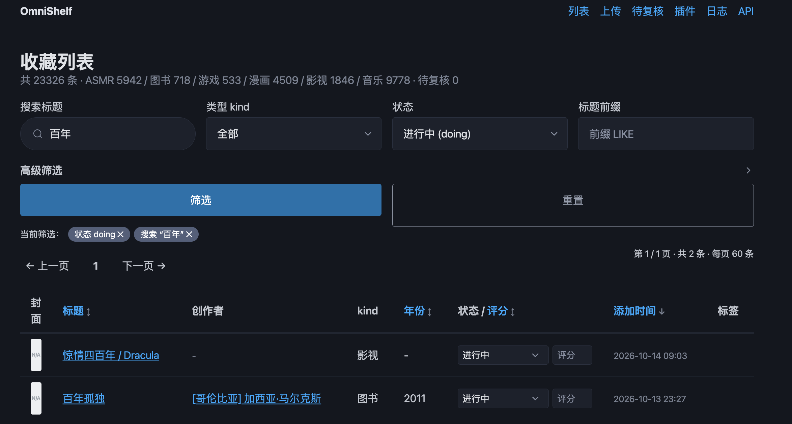
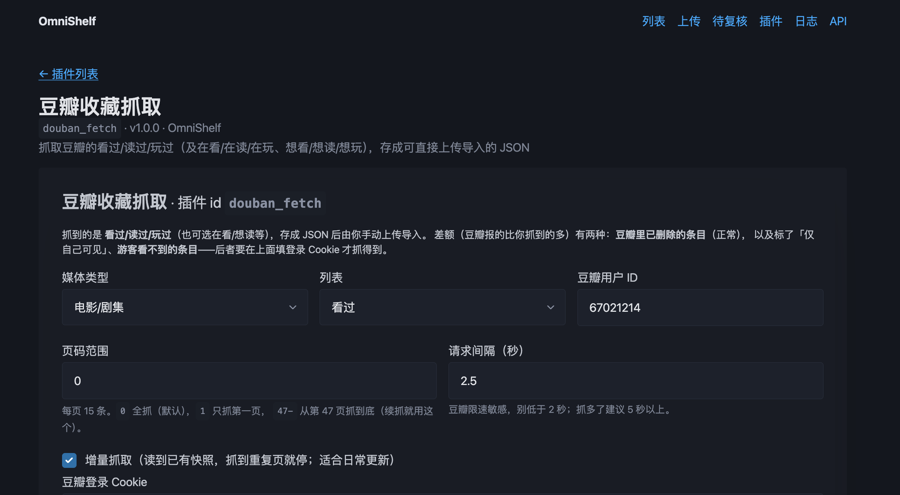

<div align="center">

# OmniShelf

**一个本地的个人收藏夹中枢管理系统，将不同来源的作品统一归档，方便查询与备份。**


图书 · 漫画 · 影视 · 音乐 · 游戏 · ASMR



</div>

---

## 目录

- [为什么需要它](#为什么需要它)
- [核心亮点](#核心亮点)
- [项目状态](#项目状态)
- [快速开始](#快速开始)
- [用 Web 界面管理](#用-web-界面管理)
- [用命令行管理](#用命令行管理)
- [接入你的收藏](#接入你的收藏)
- [判重规则](#判重规则)
- [数据与备份](#数据与备份)
- [项目结构](#项目结构)
- [数据模型](#数据模型)
- [环境变量](#环境变量)
- [给开发者](#给开发者)
- [文档索引](#文档索引)

---

## 为什么需要它

收藏存在别人的服务器上，就要承担三种风险：

| 风险 | 意味着什么 |
| --- | --- |
| **作品下架** | 平台内容可能被删除 |
| **服务停止** | 站点关闭，收藏随之消失 |
| **账号失效** | 封号、注销、忘记密码，数据无法找回 |

如果想要规避风险，需要逐一备份，工作量大且不同来源的备份数据难以管理。
**OmniShelf 解决这些问题**：将所有来源的收藏统一入库、统一管理、统一备份，让数据真正属于你自己。

---


## 核心亮点

* 🗂️ **统一格式管理**
  不同来源的作品进了同一个库：一套通用字段（标题 / 副标题 / 创作者 / 年份 / 状态 / 评分 / 备注 / 标签）
  加一份类型专属字段，一处搜索、筛选、排序、导出。不用记住「豆瓣的数据在哪个文件里、哔咔的收藏在哪份 JSON 里」。

* 🔌 **插件化扩展**
  接一个新来源不用改本体：`plugins/<插件>/` 一个目录加一份 `metadata.toml` 就是插件，
  改完刷新页面即生效（热重载）。抓取、批量清洗、可视化、导出成别的格式都写在插件里。

* ⚡ **快速同步**
  抓取支持**全量 / 增量 / 指定范围**，增量只翻没翻过的部分；后台跑 + 实时进度条，
  切走页面回来还在跑，中途断了下一次接着来。本地音乐几千上万个文件也只读每个文件头部
  那几百字节的标签，不整读文件。

* 💻 **双模式使用**
  Web 界面（搜索 / 高级筛选 / 排序 / 分页 / 行内编辑 / 封面上传 / 上传数据页 / 待复核 / 实时日志）
  与命令行（`omnishelf <cmd>`，几乎每条都支持 `--json`）操作的是**同一个库、同一套判重规则**——
  喜欢点就用网页，喜欢写脚本或做定时任务就用 CLI。

* 🤖 **AI 友好**
  插件完整支持命令行调用，方便被外部程序或 AI 工具集成使用：
  `omnishelf plugin <插件 id> <命令> [--参数 ...]`，参数表由方法签名自动生成、docstring 就是帮助文本，
  输出可以稳定吃 `--json`。宿主自己的数据接口同样有 `/api/*` 的 JSON 版本。

---

## 项目状态

早期版本（**v0.1.0-alpha**），核心功能闭环已实现，可正常使用。欢迎试用并反馈。

---

## 快速开始

需要 **Python 3.11+**。

### 1. 安装

**A. 用 uv（推荐）**

```bash
cd omnishelf
uv sync --dev
uv run omnishelf --help
```

**B. 用 pip + venv**

```bash
cd omnishelf
python3 -m venv .venv
source .venv/bin/activate          # Windows: .venv\Scripts\activate
pip install -e '.[dev]'
omnishelf --help
```

> **国内网络**慢的话换镜像（版本与 hash 不变）：
>
> ```bash
> UV_DEFAULT_INDEX=https://pypi.tuna.tsinghua.edu.cn/simple uv sync --dev
> pip install -i https://pypi.tuna.tsinghua.edu.cn/simple -e '.[dev]'
> ```

### 2. 建库

```bash
omnishelf init          # 建 data/collection.db + 迁移，幂等，可以反复跑
```

### 3. 打开 Web 界面

```bash
omnishelf serve                          # http://127.0.0.1:8765
omnishelf serve --host 127.0.0.1 --port 9000
```
打开“插件”页面，配置好相关信息后，从不同来源抓取并导入收藏。

### 4. 使用cli

可以不起server直接在cli运行
```bash
# 本地音乐：挑一个目录，读标签生成清单，确认后入库
omnishelf scan-music ~/Music --out music_scan.json
omnishelf import music_scan.json --importer music_files
omnishelf scan-music ~/Music --import          # 或者一步到位

# 其它来源：先在插件页抓出一份 JSON，再导入（见「接入你的收藏」）
omnishelf import douban_movies.json --importer douban_movies
```

---

## 用 Web 界面管理

| 路由 | 能做什么 |
| --- | --- |
| `/` | 列表：关键词搜索、类型/状态/标签筛选、高级筛选（评分区间 · 入库日期 · 创作者 · 标签包含排除）、点表头排序、分页、封面缩略图、状态与评分**行内编辑**、创作者可点进同作者的其它作品 |
| `/items/{id}` | 详情：封面、通用信息与类型专属字段分块排列、来源标识与导入时间线、封面上传 |
| `/upload` | 上传数据页：选 importer + 上传文件，原始文件按来源存档 |
| `/review` | 待复核：模糊匹配到的疑似重复，左右并排对比后由你决定合并还是跳过 |
| `/plugins` | 插件列表：状态、日志入口、重载 |
| `/plugins/{id}` | 插件自己的页面（抓取表单、进度条、报告） |
| `/logs` | 运行日志：宿主与插件写在同一条时间线上，实时刷新，按插件、级别、条数筛 |
| `/api/docs` | JSON 接口文档（`/api/items`、`/api/stats`、`/api/review`、`/api/health` …） |

前端零构建（HTMX + Pico.css 随仓库内置），没有 node_modules。

---

## 用命令行管理

```bash
omnishelf init
omnishelf import <file> [<file> ...] --importer <name> [--strict] [--json]
omnishelf scan-music <目录或文件 ...> [--out PATH] [--import] [--json]
omnishelf list   [--kind K] [--status S] [--tag T] [--title-prefix P] [--search Q] [--creator C]
                 [--rating-min X] [--rating-max Y] [--created-from D] [--created-to D]
                 [--with-tag T ...] [--without-tag T ...]
                 [--sort title|rating|year|created_at|updated_at] [--reverse]
                 [--limit N] [--page N] [--json]
omnishelf show <id> [--json]
omnishelf edit <id> [--status S] [--rating R|none] [--title T] [--subtitle T] [--year N]
                    [--notes T] [--tag T ...] [--add-tag T] [--remove-tag T]
omnishelf review list [--json]
omnishelf review merge <pending_id> --keep <item_id>
omnishelf review skip <pending_id>
omnishelf export --format json --out PATH [--kind K] [--include-deleted]
omnishelf plugins list [--json]
omnishelf plugins reload [PLUGIN_ID]
omnishelf plugin                              # 插件注册的命令总览
omnishelf plugin <插件 id>                     # 这个插件有哪些命令、什么参数
omnishelf plugin <插件 id> <命令> [--参数]      # 执行（-h 看详细帮助）
omnishelf data-commit -m MSG
omnishelf serve [--host H] [--port P] [--reload]
omnishelf demo [--keep] [--out PATH] [--demo-dir DIR]
```

全局选项 `--data-dir PATH`（等价于环境变量 `OMNISHELF_DATA_DIR`），一条命令可以指到别的数据目录上跑。

---

## 接入你的收藏

数据进来的路子只有两种：**插件负责抓**，**importer 负责放**。
抓回来的中间产物都是文件，落到磁盘上、可以反复导入、可以先看一眼再入库。

### 现成插件（`plugins/`，随仓库分发）

| 插件 | 抓什么 | 落到哪个 importer |
| --- | --- | --- |
| `douban_fetch` | 豆瓣的看过 / 读过 / 玩过（可带登录 Cookie，把「仅自己可见」的条目也抓全） | `douban_movies` / `douban_books` / `douban_games` |
| `asmr_playlist` | ASMR.ONE 的公开播放列表或私人收藏（全量 / 增量 / 指定范围） | `asmr_one` |
| `copymanga_fetch` | 拷贝漫画的书架收藏（增量 / 全量，全量顺带标出已取消收藏的） | `copymanga` |
| `picamanga_fetch` | 哔咔（Picacomic）收藏夹（增量 / 全量，可配代理） | `picamanga` |
| `music_import` | 本地音乐：用系统选择框挑一个文件夹或多个文件，读标签生成清单后直接入库 | `music_files` |
| `kind_chart` | 按类型 / 状态画条状图，同时是**插件模板**——照它抄一个自己的插件最快 | — |

抓取全部在后台跑、有进度条、支持续抓；要认证的几家（令牌或用户名密码）**密码不落盘**，
令牌存进 `plugins_data/<插件>/config.toml`（那个目录不进 git），下次留空即沿用。

### 内置 importer（`omnishelf import --importer <名字>`）

| 名字 | 认的输入 | 类型 |
| --- | --- | --- |
| `douban_movies` / `douban_books` / `douban_games` | 豆瓣插件产出的 JSON | movie / book / game |
| `asmr_one` | ASMR.ONE 插件产出的 JSON（顶层 `{"works": [...]}`） | asmr |
| `copymanga` / `picamanga` | 对应漫画插件产出的 JSON | manga |
| `music_files` | `omnishelf scan-music` 产出的清单，也认手写的 `{"items": [...]}` / `[...]` | music |
| `itunes_xml` | iTunes「资料库导出 XML」（标准库直读，不装 mutagen） | music |
| `json_movies` / `json_books` | 通用 JSON（`[...]` 或 `{"items": [...]}`，也认 `records` / `data` / `works`） | movie / book |

自己的格式？写一个 importer 只要声明字段映射——
见 [`docs/development.md`](docs/development.md) 的「写一个新的 importer」一节。
（CSV 只给基类，各家表头写法都不一样，不预置具体的 CSV importer。）

---

## 判重规则

导入时**按顺序**做唯一性检查，命中即停：

| # | 检查 | 语义 |
| --- | --- | --- |
| 1 | **同源**：这条我导过没有（比唯一标识） | **更新**：外部数据权威，覆盖非空字段 |
| 2 | **非同源 · 精确**：类型 + 标题 + 年份完全一致 | **合并**：只补空字段 + 合并标签 |
| 3 | **非同源 · 模糊**：类型 + 标题相似 | **绝不自动合并**：存为新条目并进取待复核，由你决定 |

口径是「**同源只认唯一标识，标题只用于非同源**」：同一个来源里两条记录只要唯一标识不同，
就是两件作品，各自入库、互不覆盖（标题一样也一样）。

是否跨来源比较由类型决定：

* **默认开启**——同一作品可能出现在多个来源，命中后进待复核；
* **漫画关闭**——同一部漫画在不同站点是不同来源的独立收藏，只查同源内部重复；
* **音乐按内容判重**——本地文件没有稳定唯一标识，认「标题 + 专辑 + 艺术家」三项一致
  （同一首歌换个码率、换个文件名还是那一首），命中就地合并。

手工录入（来源未知）的条目用标题比对，避免重复导一遍。
规则出处见 [`docs/development.md`](docs/development.md) 的「判重与来源」一节。

---

## 数据与备份

**代码和数据是两个互不干涉的 git 仓库。**

| 仓库 | 位置 | 内容 | 可见性 |
| --- | --- | --- | --- |
| 主仓库 | 本目录 | 代码、文档、`plugins/` | 可以公开，不含任何数据 |
| 数据仓库 | `data/` | `collection.db`、`attachments/`、`imports/`、`logs/` | **务必私有** |

插件的配置与产出写在 `plugins_data/<插件 id>/`（含令牌，同样不进 git）。
`pytest` 和 `omnishelf demo` 都不依赖真实数据。

---

## 项目结构

```
.
├── pyproject.toml          依赖、命令入口、pytest / mypy 配置、版本号
├── uv.lock                 锁定的依赖版本
├── LICENSE                 MIT
├── README.md               本文件
├── CHANGELOG.md            变更历史
├── docs/
│   ├── development.md      开发约定与规则出处
│   └── plugin-development.md  插件开发指南
├── migrations/             按编号顺序执行的表结构变更（SQL）
├── src/omnishelf/          本体代码
│   ├── cli.py              命令行入口
│   ├── web/                Web 界面（路由 + 模板 + 零构建静态资源）
│   ├── importers/          各来源的字段映射与注册表
│   ├── services/           导入 / 判重 / 封面 / 导出 / 待复核 / data-commit
│   ├── plugins/            插件运行时（加载、热重载、SDK、宿主接口、日志）
│   ├── audiotags.py        本地音频标签读取（只用标准库）
│   └── music_scan.py       音乐文件扫描 → 清单 JSON
├── plugins/                随仓库分发的插件（一个目录一个插件）
│   ├── kind_chart/         示例兼模板：照它抄最快
│   ├── douban_fetch/       豆瓣收藏抓取
│   ├── asmr_playlist/      ASMR.ONE 播放列表 / 私人收藏抓取
│   ├── copymanga_fetch/    拷贝漫画书架抓取
│   ├── picamanga_fetch/    哔咔收藏夹抓取
│   └── music_import/       本地音乐导入
├── tests/                  全离线测试 + 合成数据夹具（不含任何真实收藏数据）
│   ├── fixtures/           importer 用的合成样本
│   └── plugin_fixtures/    插件抓取用的合成响应
├── plugins_data/           插件的配置、令牌、抓取产物（不进 git）
└── data/                   你的收藏数据：库、封面附件、导入原文、运行日志（独立仓库，不进 git）
```

* **进 git 的**：代码、文档、`plugins/`、`tests/`——这里面一点真实数据都没有。
* **不进 git 的**：`data/`（独立仓库）与 `plugins_data/`（含凭据），两者都写在 `.gitignore` 里。

---

## 数据模型

| 表 | 说明 |
| --- | --- |
| `items` | 主表。通用字段：标题 / 副标题 / 创作者（多值）/ 年份 / 状态 / 评分 / 备注；`extra` 是 JSON 列，放各类型专属字段 |
| `external_ids` | 每条数据的来源标识，用于判重与跨来源匹配 |
| `tags` | 标签 |
| `import_logs` | 每次导入的审计记录（存档文件在哪、导入多少条、跳过哪些） |
| `pending_merges` | 模糊匹配产生的待复核项，**永不自动合并** |

* 类型（kind）由注册表声明专属字段：`book` / `manga` / `movie` / `asmr` / `music` / `game`。
* 时间戳统一 UTC，由系统维护；评分内部统一 0–10，`None` 表示未评分。
* 表结构变更走 `migrations/` 里的 SQL 迁移文件，`omnishelf init` 按序补齐。

---

## 环境变量

| 变量 | 用途 | 默认 |
| --- | --- | --- |
| `OMNISHELF_DATA_DIR` | 数据目录 | `<repo>/data` |
| `OMNISHELF_MIGRATIONS_DIR` | 迁移文件目录 | `<repo>/migrations` |
| `OMNISHELF_PLUGINS_DIR` | 插件目录 | `<repo>/plugins` |
| `OMNISHELF_PLUGINS_DATA_DIR` | 插件配置与数据目录 | `<repo>/plugins_data` |
| `OMNISHELF_FIXTURES_DIR` | 示例/合成数据目录（demo 与测试用） | `<repo>/tests/fixtures` |
| `OMNISHELF_GIT_BIN` | git 可执行文件 | `git` |

---

## 给开发者

```bash
uv run pytest -o addopts="" -q     # 全部离线，只用 tests/fixtures/ 里的合成数据
.venv/bin/python -m mypy           # 类型检查（非 strict 配置）
```

* **加一个类型**：改 `src/omnishelf/kinds.py` 的注册表，声明专属字段与判重策略。
* **写一个 importer**：继承基类、声明字段映射，`@register("名字")` 就进注册表——
  复制现成的那份改 `source` / `mapping` 是最快的路子。
* **写一个插件**：复制 `plugins/kind_chart/`，一个目录 + `metadata.toml` + `Plugin` 子类；
  页面热重载，不用重启服务。插件只允许 `import` 标准库、`omnishelf.plugins.api` 和自己带的工具包，
  只允许写 `plugins_data/<自己的 id>/`。

---

## 文档索引

| 文档 | 内容 | 给谁看 |
| --- | --- | --- |
| 本文件 | 定位、安装、Web、CLI、数据来源、判重、备份 | 使用者 + 想快速上手的开发者 |
| [`docs/development.md`](docs/development.md) | 分层与铁律、目录结构、迁移、kind 注册表、判重与来源、字段口径、怎么写 importer、排错速查、发布流程 | 改本体代码的人 |
| [`docs/plugin-development.md`](docs/plugin-development.md) | 插件目录约定、基类与生命周期、`ctx` 接口、页面、命令行桥接、热重载、规范红线 | 写插件的人 |
| [`CHANGELOG.md`](CHANGELOG.md) | 版本变更 | 想知道最近改了什么的人 |
| [`LICENSE`](LICENSE) | MIT | 想确认能怎么用的人 |

---

## 许可

MIT，见 [`LICENSE`](LICENSE)。

数据不在许可范围内，也不会进仓库：`data/` 与 `plugins_data/` 都被 `.gitignore` 忽略，
公开出去的只有代码、文档和合成测试数据。

---


